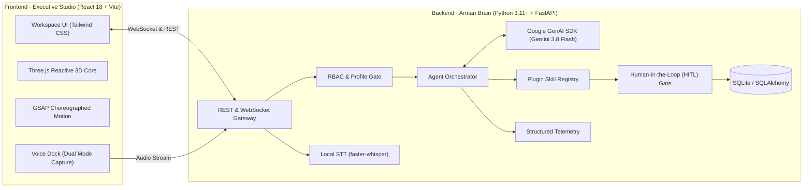

# Arman AI — Executive Agentic Personal Secretary (v1 MVP)

> **Modular, local-first Agentic AI Personal Secretary designed for non-tech everyday users and busy professionals.**

[](https://fastapi.tiangolo.com/)
[](https://react.dev/)
[](https://threejs.org/)
[](https://ai.google.dev/)
[](https://github.com/SYSTRAN/faster-whisper)
[](LICENSE)

---

## ✦ System Architecture

Arman AI follows a strict separation of concerns with an extensible, local-first foundation. The identical FastAPI brain powers the desktop interface and will seamlessly connect to future mobile clients (iOS / Android) without modifying business logic.



---

## ✦ Key Features

- **Reactive 3D WebGL Core**: Real-time Three.js metallic icosahedron and orbiting particle field dynamically reflecting Arman's internal state (`IDLE`, `LISTENING`, `THINKING`, `EXECUTING`, `AWAITING_APPROVAL`, `COMPLETED`, `ERROR`).
- **Human-in-the-Loop (HITL) Safety Guard**: High-risk actions (e.g., messaging, email sending) pause execution, store pending approval cards in SQLite, and require explicit `Approve / Edit / Cancel` before dispatching.
- **Local Voice Capture**: Dual-mode microphone recording (push-to-talk & click-to-record) powered by local `faster-whisper` with graceful fallback and user review before execution.
- **Modular Plugin Skill Registry**: Drop-in Python skills inheriting from `BaseSkill` with auto-discovery, risk levels, and plan-tier access control.
- **Lightweight RBAC & Profile Isolation**: Multi-profile support (e.g., Admin vs. Family member) with strict data isolation for reminders, contacts, conversations, and approvals.
- **Hardware Kill Switch**: Instant server-side pause guard toggleable from the top status bar.
- **Awwwards-Inspired Dark Minimalist UI**: High-contrast matte obsidian palette (`#080809`), hairline borders (`#2F2F2F`), editorial typography (`Space Grotesk`, `Inter`, `JetBrains Mono`), and zero tacky neon gradients.

---

## ✦ Included Starter Skills (v1)

| Skill | Risk Level | Access Tier | Description |
|---|---|---|---|
| `youtube_skill` | `safe` | Free | Opens YouTube or executes desktop browser search queries. |
| `food_search_skill` | `safe` | Free | Searches local food spots, restaurants, or recipes. |
| `reminders_skill` | `safe` | Free | Full SQLite CRUD management for personal reminders and deadlines. |
| `contacts_skill` | `safe` | Free | Stores and retrieves relationship contacts (phone, email, notes). |
| `draft_action_skill` | `requires_approval` | Free | Drafts refined emails/messages with contact auto-resolution and an Approval Gate. |

---

## ✦ Tech Stack

### Backend
- **Framework**: FastAPI (Async `lifespan` context manager, WebSockets, REST)
- **Language**: Python 3.11+
- **LLM SDK**: Official `google-genai` SDK (`gemini-3.8-flash` primary, `gemini-3.5-flash-lite` fallback)
- **Local Speech-to-Text**: `faster-whisper` running asynchronously via `asyncio.to_thread`
- **Database & ORM**: SQLite + SQLAlchemy 2.0
- **Validation**: Pydantic v2

### Frontend
- **Runtime**: React 18 + TypeScript + Vite
- **3D Graphics**: Three.js via `@react-three/fiber` and `@react-three/drei`
- **Animation**: GSAP 3 + `@gsap/react`
- **Styling**: Tailwind CSS v3 with customized design tokens
- **State Management**: Zustand v5
- **Icons**: Lucide React
- **Typography**: `@fontsource/space-grotesk`, `@fontsource/inter`, `@fontsource/jetbrains-mono`

---

## ✦ Quick Start

### 1. Prerequisites
- **Node.js** 18.x or 20.x
- **Python** 3.11+
- **Gemini API Key**: Obtain from [Google AI Studio](https://aistudio.google.com/)

---

### 2. Backend Setup

```bash
cd backend

# Create and activate virtual environment
# Windows (PowerShell):
python -m venv venv
.\venv\Scripts\Activate.ps1

# macOS / Linux:
# python3 -m venv venv
# source venv/bin/activate

# Install dependencies
pip install -r requirements.txt

# Configure environment variables
cp .env.example .env
# Edit .env and paste your GEMINI_API_KEY
```

---

### 3. Frontend Setup

```bash
cd ../frontend

# Install dependencies
npm install

# Configure environment variables (optional defaults to localhost:8000)
cp .env.example .env
```

---

### 4. Running Arman AI Locally

Start both servers in separate terminal tabs:

**Terminal 1 — Backend Brain:**
```bash
cd backend
uvicorn main:app --reload --port 8000
```

**Terminal 2 — Executive Studio:**
```bash
cd frontend
npm run dev
```

Open [http://localhost:5173](http://localhost:5173) in your browser.

---

## ✦ Verification & Testing

Run the automated backend test suite:
```bash
cd backend
python -m pytest tests/ -v
```

Run frontend type checking and production build:
```bash
cd frontend
npm run build
```

---

## ✦ License

Distributed under the MIT License. See `LICENSE` for more information.
